  

  
  
  

---

### 👋 About me

I'm a third-year **Mechanical Engineering** student at the **Indian Institute of Petroleum and Energy (IIPE)**, Visakhapatnam. I work where three things meet:

| ⚙ **Engineer** | ◈ **Compute** | ▲ **Consult** |
|:--|:--|:--|
| Propulsion, structures and machines, sized from first principles and modelled in SolidWorks / Fusion 360 | Parametric sweeps, simulations and data pipelines in MATLAB and Python | Six Sigma, business cases and NGO strategy as founding president of **180 Degrees Consulting IIPE** |

- 🚀 Presenting a paper on a **spiral-vane pintle injector** at **NCCS, December 2026**
- 🏭 Interned at **SEC Industries** (aerospace hardware), **BSERC** (def-space tech) and **NHPC** (hydropower O&M)
- 🌱 Currently learning: FEA and CFD workflows, operations research, Python for engineering

---

### 🛠 Featured projects

<table>
  <tr>
    <td width="50%" valign="top">
      <h4>🚀 <a href="https://github.com/prathiitsharma-cmd/Pintle-Injector-Re-Design">Pintle Injector Re-Design</a></h4>
      
Throttleable spiral-vane manifold for a LOX/LCH4 pintle injector, inspired by Francis-turbine spiral casings. Sized in MATLAB against a NASA CEA design point (O/F 3.2, 750 N, 20 bar).

         
    </td>
    <td width="50%" valign="top">
      <h4>🛩 <a href="https://github.com/prathiitsharma-cmd/UAV-Pneumatic-Launcher">UAV Pneumatic Launcher</a></h4>
      
Catapult launcher sized from a 396-point sweep of launch angle × UAV mass. Governing case 20 kg @ 15° → 125 mm ISO 6431 bore, buckling FoS 5.5, all 396 conditions verified.

        
    </td>
  </tr>
  <tr>
    <td width="50%" valign="top">
      <h4>📊 <a href="https://github.com/prathiitsharma-cmd/Six-Sigma-Invoicing">Six Sigma Invoicing</a></h4>
      
Six Sigma (DMAIC) case on supplier invoice errors. Python pipeline searching 25,599 solution combinations with 20,000 Monte Carlo runs → hybrid plan with a 90% error cut and 9-month payback (base case).

        
    </td>
    <td width="50%" valign="top">
      <h4>🌐 <a href="https://github.com/prathiitsharma-cmd/prathiitsharma-cmd.github.io">Portfolio website</a></h4>
      
My site: a Three.js particle cloud that morphs between a gear, a neural net and a rising chart, one shape per theme of my work. No build step, plain HTML/CSS/JS.

        
    </td>
  </tr>
</table>

---

### 🧰 Toolkit

**Design & CAD** 

**Analysis & simulation** 

**Code & data** 

**Business & quality** 

---

### 🏅 Leadership

- **Founding President**, 180 Degrees Consulting IIPE: pro-bono strategy work for NGOs
- **Social Welfare Secretary**, NSS IIPE · **Co-founder**, Sattva Quizzing Club
- **National Finalist**, Socionnovate · **Finalist**, SpringFest Quiz

  

